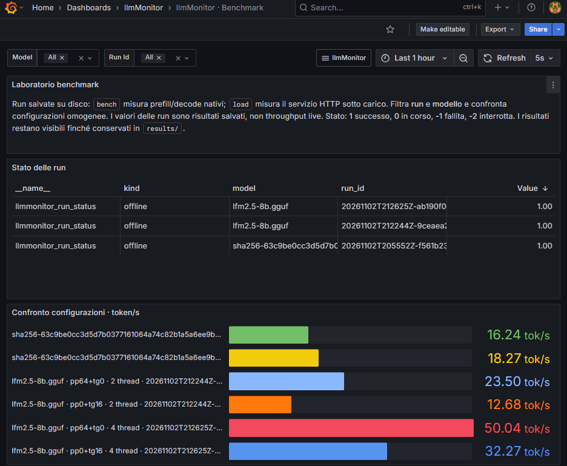

# llmMonitor

Monitoraggio locale e benchmark per llama.cpp. Il modello gira sull'host; Grafana, Prometheus e l'exporter girano in Docker. Dati e risultati rimangono sul computer.



## Avvio

Servono Python 3.10+, Docker con Compose v2 e un modello GGUF. Per compilare llama.cpp servono anche Git, CMake e un compilatore C++.

```bash
./scripts/bootstrap
./scripts/llm-monitor install --clone
./scripts/llm-monitor up
./scripts/llm-monitor serve --model /percorso/modello.gguf
```

`bootstrap` crea `.venv` e installa le dipendenze del collector. `install` riutilizza i binari trovati nel PATH o nei sorgenti locali; se deve compilare sceglie il backend automaticamente. Puoi selezionarlo con `--backend cpu`, `--backend cuda` o `--backend metal`.

Apri [Grafana](http://localhost:3000/d/llmmonitor-home). Le credenziali iniziali sono generate in `.env`. Le porte di Grafana e Prometheus sono pubblicate solo sul loopback; telemetria e controlli aggiornamenti Grafana sono disabilitati.

La Home mostra lo stato della raccolta, hardware e benchmark salvati. Le altre dashboard sono:

- [Hardware](http://localhost:3000/d/llmmonitor-hardware): CPU, RAM, processo osservato e misure NVIDIA disponibili.
- [Benchmark](http://localhost:3000/d/llmmonitor-benchmarks): confronto delle run e delle configurazioni.
- [llama.cpp Live](http://localhost:3000/d/llmmonitor-overview): tutte le metriche native esposte dal server.

## Una propria installazione

```bash
./scripts/llm-monitor install --backend existing --bin-dir /percorso/bin
# Oppure compila i sorgenti locali in una build separata:
./scripts/llm-monitor install --source /percorso/llama.cpp --backend cpu
```

I percorsi sono configurabili in `.env`; non sono inclusi nel repository. Il progetto cerca anche un checkout `llama.cpp` o `llamacpp` nella cartella adiacente. Le nuove build sono sotto `.runtime/` e non modificano la build originale.

Per collegare un server già avviato, abilita `--metrics` e imposta:

```dotenv
LLAMA_URL=http://host.docker.internal:8080
LLAMA_LOCAL_URL=http://127.0.0.1:8080
```

`LLAMA_URL` deve essere raggiungibile dal container exporter; `LLAMA_LOCAL_URL` viene usato dagli script dell'host. Se Docker non raggiunge un server WSL tramite `host.docker.internal`, configura il suo IP raggiungibile dai container. Per un router imposta anche `LLAMA_METRICS_MODEL`.

`serve` usa `0.0.0.0` per il collegamento dei container: la raggiungibilità dalla LAN dipende da rete e firewall. `LLAMA_API_KEY` configura l'autenticazione senza inserire la chiave negli argomenti del processo.

## Benchmark e demo

```bash
# Due run distinte, con 2 e 4 thread:
./scripts/llm-monitor demo --model /percorso/modello.gguf

# Più modelli e una matrice di configurazioni:
./scripts/llm-monitor bench \
  --model /modelli/A.gguf --model /modelli/B.gguf \
  --threads 4,8 --gpu-layers 0,99 \
  --prompt-tokens 128,512 --tokens 128 --repetitions 5

./scripts/llm-monitor compare --csv results/comparison.csv
```

`bench` usa llama-bench e salva comando, parametri, metadati, output originale e log in `results/<run_id>/`. I risultati appaiono nella dashboard Benchmark anche se il server HTTP è fermo. Per confronti isolati, ferma prima un eventuale server che occupa RAM/VRAM.

Per osservare il servizio durante un carico HTTP:

```bash
./scripts/llm-monitor serve --model /modelli/A.gguf --alias modello-A --parallel 4
./scripts/llm-monitor load \
  --model modello-A --requests 40 --concurrency 4 --tokens 256 \
  --prompt-file examples/prompt.txt
```

`load` usa streaming, un warmup escluso dalle statistiche, cache del prompt disattivata e seed registrati. Misura throughput aggregato, errori, latenza e tempo al primo contenuto, con media/p50/p95. I token vengono letti dai dati nativi del server. Una risposta incompleta o una richiesta fallita produce un errore, non un punteggio valido.

[Come preparare le viste per gli screenshot](docs/screenshots.md).

## Gestione

| Comando | Funzione |
| --- | --- |
| `setup` | Crea configurazione privata e directory dei dati |
| `install` | Collega binari esistenti o compila llama.cpp |
| `up` / `down` | Avvia o ferma monitoring e collector; conserva i volumi |
| `serve --model FILE` / `stop` | Avvia o ferma il server gestito |
| `collect --pid PID` / `collect-stop` | Controlla il collector e il processo osservato |
| `status` / `logs SERVICE` | Mostra stato e log |
| `doctor` | Controlla binari, Docker e API del modello |
| `diagnose` | Verifica dashboard, scrape Prometheus e presenza dei dati |
| `demo`, `bench`, `load`, `compare` | Esegue e confronta esperimenti |

Per tutte le opzioni: `./scripts/llm-monitor COMANDO --help`. È disponibile anche l'entry point `scripts/llm-monitor.ps1`.

`up` ricostruisce le immagini e riavvia automaticamente un collector che usa una versione precedente del codice. Per fermare anche il modello usa `down --server`.

## Se i pannelli sono vuoti

```bash
./scripts/llm-monitor diagnose
```

Il comando controlla Grafana, il provisioning delle dashboard, i target Prometheus e l'età dello snapshot hardware; salva il report in `.runtime/diagnostics.json` senza credenziali.

La dashboard Live richiede un server attivo con `--metrics`; `up` avvia il monitoraggio, non il modello. Un benchmark offline alimenta la dashboard Benchmark. Hardware richiede un collector attivo. Misure non disponibili o snapshot più vecchi di 15 secondi non vengono sostituiti con zeri.

## Dati e sviluppo

[Significato delle metriche](docs/metrics.md). Il collector campiona ogni 2 secondi e Prometheus ogni 5. I risultati salvati restano esposti finché presenti in `results/`; archiviare le vecchie run fuori da questa cartella riduce il numero di serie. La retention Prometheus iniziale è di 15 giorni.

```bash
.venv/bin/python scripts/check.py
.venv/bin/python scripts/generate_dashboards.py
docker compose --env-file .env config --quiet
```

La CI esegue test su runner separati, build native CPU/Metal, build immagini amd64/arm64 e un test di integrazione dello stack Grafana/Prometheus con un upstream sintetico isolato. Modelli, credenziali, log, risultati e ambiente virtuale sono esclusi dal versionamento.
